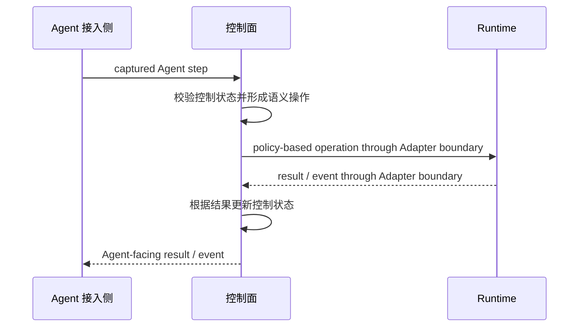

# AScout 架构

本文只定义 AScout 的一级分层、各侧责任与跨侧调用方向。Runtime 是 AScout 支持的一套完整执行与效果承载系统；Runtime Adapter 是它与控制面之间的接入边界，不是与 Runtime 平级的另一侧。Mechanism 不是额外的一侧，而是横跨 Agent 接入侧、控制面与 Runtime 的抽象实现责任。

## 1. 架构总览

Agent 接入侧上报通用 action 生命周期及 Agent/Branch 元事件，控制命令回执只确认接入侧落实；Runtime 独立报告操作、环境及资源结果。Authority/Candidate 是 Tree 的角色，不是两种 Agent 事件协议。具体边界见 [Agent 接入](design/agent-integration.md)。

用户端呈现稳定的 AScoutAgent 视图，与具体 Agent 执行实体分离。控制面确认合法 Promote 后，接入实现更新该视图对应的权威执行及输入、输出和中断路由；不通过切换或重建用户会话完成接替。用户端不新增一级架构侧面，也不拥有 Branch 接受裁决权。

Parent 取得真实 operation 结果后可以立即继续，候选验证并行进行，不以验证结束阻塞真实结果交付；合法 Promote 才使旧 Parent 失去权威并受管停止。工具准入与结果兼容性由 Policy 结合接入能力判断，operation 归属与结果配对由 Mechanism 保证。

用户端还可提供独立于主对话的只读候选观察，显示候选运行事实和明确标记为未验证的内容；观察不改变权威输出路由，不给候选建立用户输入通道，也不将观察内容反馈给其他 Branch。生命周期状态取自控制面，实际执行活动由接入侧报告，环境操作完成与否依据实际返回结果展示，不以命令已发出代替完成。

AScout 的用户界面接收并呈现 Agent 输出与运行事件，不依赖某个 Agent 产品的原生界面；产品差异由对应 Agent 接入实现处理。观察覆盖当前 AScoutAgent 的完整 Tree，支持从 Branch 关系与状态进入具体 Branch 的只读详情，不提供跨 Tree 查询或生命周期裁决权限。

AScout 的完整调用路径涉及 Agent 接入侧、控制面和 Runtime。控制面一侧通过 Agent 接入边界接收 Agent 行为，另一侧通过 Runtime Adapter 使用 Runtime。Agent 接入侧与控制面是 AScout 自身可以定义和实现的系统部分；Runtime 是 AScout 支持的完整承载系统；Runtime Adapter 负责把 Runtime 接入控制面。

Agent 接入侧围绕一组 Agent 进程及其执行活动提供本地管理。Branch 为执行活动提供逻辑归属，Agent 接入侧为每个 Branch 承载独立的本地管理上下文；控制面通过接入侧获取 Agent 行为事实、发出控制命令，并协调 Branch 与 Instance 的全局状态。多个 Branch 可以在共享执行环境和接入侧承载中共存，Branch 建立独立环境后，其管理上下文随执行活动进入相应环境。

控制面负责维护投机执行过程当中 Agent 的控制状态，特别是由多次投机执行组合嵌套形成的拓扑结构。同时还负责执行过程中的决策和检查，Policy 和 Adapter 都以可插拔的形式与该结构连接。这也意味着控制面还负责根据 Adapter 接入契约校验其是否符合 AScout 所要求的基本语义，并解析回传事件；加载与校验 Policy，并检查 Adapter 所声明和呈现的后端能力是否满足 Policy 需求。逻辑 Branch 可以先进入控制面视图，独立 Runtime 环境按需建立，不要求每次投机执行都立即 fork。

控制面定义自己接受的稳定 operation/event 边界和接入条件。Runtime Adapter 依据该边界，把 Runtime 的能力映射成控制面可以使用的能力，并规范化结果与事件。Runtime 内部可以组合 Overlay、进程、容器、Firecracker、效果协调等能力；AScout 不规定这些内部模块如何组织或选择 transport，但要求接入边界如实呈现能力和限制。

Runtime 承载 Agent 的一步动作，使动作能够正常、正确地运行，并把动作对真实世界或 authority 的影响限制在允许范围内。Runtime 负责动作所需的环境、状态派生、隔离、资源、进程和效果边界；这些能力可以按任务需要共享、复制、写时复制、重建或恢复。Agent Session 的内部管理由 Agent 接入侧负责。Agent-facing integration 组件可以部署在 Runtime 提供的环境内，其运行生命周期随该环境管理。

控制面的具体投机状态集中在各 task 的 Speculative Tree。Controller 负责树、Policy 函数和外部操作之间的协调，不持有 task 的投机状态，可以供多棵树使用。消息与到期检查按 task 顺序处理；Runtime 操作和 Policy 求值异步返回，由树校验并应用。事件等待和通信入口不承担投机策略或状态转换职责。

### 1.1 架构边界

- 所有跨边界的操作都必须遵守路径。跨侧可以传输受契约约束的请求、命令、结果和事件，但不能越过相邻边界直接控制其他侧，也不共享跨侧可变状态；调用方不能仅凭发送请求或更新自身状态伪造目标侧已完成的状态。
- 控制面不接受会放宽 AScout 基本语义的 Adapter 结果；策略需求与 Adapter 声明或实际兑现的能力不匹配时，由控制面拒绝或明确降级。
- 所需 OS privilege 留在 Runtime 实现一侧，Agent 接入侧、控制面与 Runtime Adapter 不持有这些特权。Runtime 的特权只用于其声明的环境、进程、资源、隔离和效果边界；接入侧不能绕过 Runtime 或控制面直接扩大动作影响范围。

## 2. 控制闭环

一次需要 Runtime 参与的操作形成完整闭环：



控制面是整体 Speculative Tree 和控制语义的权威来源。Runtime 内部的执行、资源、环境和效果状态由 Runtime 管理；控制面通过 Runtime Adapter 接收能力、结果与事件，不直接读取 Runtime 内部状态。

## 3. 责任与状态边界

各责任边界如下（控制面各组件的职责与协作见 [控制面设计](design/control-plane.md)）：

| 侧面 | 组件 | 状态 |
|---|---|---|
| Agent 接入侧 | Interposer（拦截与操作集成）、ASC-Proxy（受管控制通信）、Product Integration（产品接入） | 当前 Agent 与 Branch 的本地执行上下文 |
| 控制面 | Agent Control Gateway、Adapter Registry、Policy Engine、Speculation Coordinator、Ledger | AScoutAgent 与 Speculative Tree 控制状态、Policy 绑定、Adapter 接入状态 |
| Runtime | 包含 Runtime Adapter 接入边界及所需的执行、状态派生、进程、资源、隔离和效果管理能力 | 管理实际承载和效果状态；不决定 Speculative Tree 的全局裁决，不呈现第二份 Tree 权威状态 |

特别的，ASC-Proxy、Interposer 等 Agent 接入侧组件可以运行在 Agent 执行实体当前使用的执行环境内；该环境可以是多个逻辑 Branch 暂时共享的执行环境，也可以是 Runtime 为某个 Branch 建立的独立环境。

## 3.1 代码模块结构

`src/` 按职责分为三个顶层模块，`lib.rs` 只声明它们：

```text
src/
  lib.rs
  protocol/                    线上契约与传输编解码
    mod.rs  contract.rs  transport.rs
  control_plane/               控制面
    mod.rs
    agent_control/             Tree、Branch、命令/事件与协议消息
    coordination/              动作投影与 AgentController
    ledger.rs
    policy/                    YAML 编译、Python 求值、Decision、校验
    session.rs                 会话与请求客户端
  runtime/                     Runtime Adapter 进程与通用组合层
    mod.rs
    adapter/                   会话、队列、结果缓存、分发、Agent 子进程
    backend.rs                 Backend trait、BackendContext、错误类型
    base.rs                    BaseRuntime
    composite.rs               CompositeRuntime
    capabilities.rs            多 Backend 能力合并
    selection.rs               选择 Policy、路由与 BackendConnection
    process/                   bwrap 启动、cgroup、freeze、handle
    backends/
      mod.rs
      filesystem/              文件系统 Backend
      firecracker/             Firecracker Backend 与 guest_access
      nle.rs                   NLE Backend
  bin/                         可执行入口，仅做装配与 import
```

文件系统 Backend 继续按职责拆分：`config`、`state`（环境/挂载/快照/迁移）、
`probe`、`refs`、`mounts`、`btrfs`、`ops/{fork,mark,diff,accept,discard}`、
`layer/`（Node/View、扫描、解析、xattr、变更列表）、`merge`、`replay/`
（SafeRoot 与重放）、`copy`、`backend_impl`、`util`、`tests/`。

依赖方向：

- `protocol` 只依赖 serde 等外部库，不依赖 `control_plane` 或 `runtime`。
- `control_plane` 依赖 `protocol`；当前不依赖 `runtime`。
- `runtime` 依赖 `protocol` 与具体 Backend；Backend 实现依赖 `runtime::backend`
  的 trait 和 `runtime::process` 的启动片段，不反向把 workload 语义加入通用
  Adapter 或控制面。
- `bin/` 依赖库的公开装配 API，不承载实现逻辑。

`BaseRuntime` 通过 `Option<Arc<dyn Backend>>` 持有 data plane，不再依赖具体
`FilesystemBackend`；具体 Backend 只由装配代码注入。

## 4. 相关文档

- [Agent 接入侧设计](design/agent-integration.md)：直接子文档，展开 Agent 接入组件与受控路径
- [控制面设计](design/control-plane.md)：直接子文档，展开控制面内部职责
- [Runtime Adapter 契约设计](design/runtime-adapter-contract.md)：Adapter 面向控制面的具体接入契约
- [Runtime Adapter 接入指南](development/runtime-adapter.md)：Adapter 作者的实现建议与控制面接入方法
- [Runtime 设计](design/runtime.md)：动作承载、状态与可插拔能力；首阶段范围见开发文档。
- [设计决策](design/decisions.md)：核心 Speculative Tree 语义选择速查
- [投机执行底座设计决策](design/speculation-decisions.md) 与 [抽象设计札记](development/spec-exec-abstraction.md)：内部组件的研究推导
- [设计模型](design-model.md)：抽象概念层
