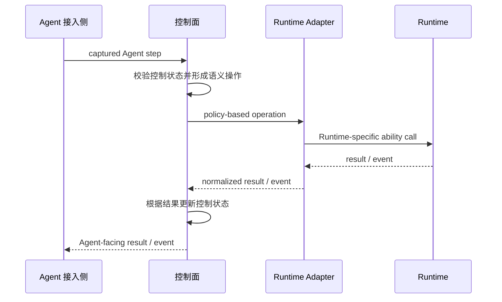

# AScout 架构

本文只定义 AScout 的一级分层、各侧责任与跨侧调用方向。四侧是一次完整调用中的逻辑位置，不表示四侧都由 AScout 实现或拥有。

## 1. 架构总览

AScout 的完整调用路径涉及四侧。控制面居于中间，两端分别通过 Adapter 类边界连接：一侧是 Agent 接入侧，其内部 ASC-Daemon / Interposer / Operation Integration 承担 Agent 侧接入适配；另一侧是外部执行 Runtime，通过 Runtime Adapter 接入。Agent 接入侧与控制面是 AScout 自身可以定义和实现的系统部分；Runtime Adapter 是面向控制面的接入实现；Runtime 是 AScout 依赖但不拥有的外部能力来源。

Agent 接入侧定义 Agent 接入/使用 AScout 的方式，绑定某个 Agent Instance 的本地上下文。控制面通过接入侧来实现对 Instance 生命周期、状态、行为、环境信息的控制。

控制面是 AScout 的主体部分，负责维护投机执行过程当中 Agent 的状态，特别是由多次投机执行组合嵌套形成的拓扑结构。同时还负责执行过程中的决策和检查，Policy 和 Adapter 都以可插拔的形式与该结构连接。这也意味着控制面还负责根据 Adapter 接入契约校验其是否符合 AScout 所要求的基本语义，并解析回传事件；加载与校验 Policy，并检查 Adapter 所声明和呈现的后端能力是否满足 Policy 需求。

控制面定义自己接受的稳定 operation/event 边界和接入条件。Runtime Adapter 的作者依据该边界，把目标 Runtime 的原生能力映射成控制面可以使用的能力，并规范化结果与事件。AScout 不规定 Adapter 内部如何调用 Runtime、如何组织模块或选择 transport；这些属于 Adapter 实现。AScout 只能通过接入校验与运行期结果判断 Adapter 是否兑现其声明，不能直接控制 Adapter 的内部行为。

Runtime 是外部执行后端，例如容器、虚拟机或进程管理能力。AScout 不定义其内部架构，也不要求它提供 AScout 专用接口。执行、隔离、资源和外部效果最终由 Runtime 的原生机制承载，但 AScout 只对 Runtime Adapter 在控制面边界上呈现的能力与行为作判断。Agent-facing integration 组件可以部署在 Runtime 提供的 Branch 隔离环境内，其运行生命周期随该环境管理，但不因此成为 AScout 可以定义的 Runtime 内部组件。

### 1.1 架构边界

- 所有跨边界的操作都必须遵守路径，并仅传输数据，而不能代为控制。跨侧调用沿 `Agent 接入侧 <-> 控制面 <-> Runtime Adapter <-> Runtime` 方向进行，各侧不越过相邻边界直接控制其他侧，也不共享跨侧可变状态。
- 控制面不接受会放宽 AScout 基本语义的 Adapter 结果；策略需求与 Adapter 声明或实际兑现的能力不匹配时，由控制面拒绝或明确降级。
- 所需 OS privilege 留在外部执行后端一侧，Agent 接入侧、控制面与 Runtime Adapter 不持有这些特权。控制面只形成效果计划与协调请求，Adapter 负责证明目标 Runtime 能用原生机制承载相应执行。

## 2. 控制闭环

一次需要 Runtime 参与的操作形成完整闭环：

控制面是整体 Speculative Tree 与控制语义的权威来源。执行、资源和机制转换状态实际存在于外部 Runtime；控制面只接受 Runtime Adapter 按接入约定返回的能力、结果与事件，不直接定义或读取 Runtime 内部状态。

## 3. 责任与状态边界

四侧在调用路径中的责任如下（控制面各组件的职责与协作见 [控制面设计](design/control-plane.md)）：

| 侧面 | 组件 | 状态 |
|---|---|---|
| Agent 接入侧 | ASC-Daemon、Interposer、Integration（Agent 接入：CLI、library、launcher 等） | 当前 Branch 的本地上下文绑定 |
| 控制面 | Agent Control Gateway、Policy Engine、Speculation Coordinator、Effect Coordinator、Ledger | AScoutAgent 与 Speculative Tree 控制状态、Policy 绑定 |
| Runtime Adapter | 实现控制面接入边界、能力映射、通信与事件规范化；内部实现由 Adapter 作者决定 | 不向控制面呈现第二份长期权威状态 |
| Runtime | 内部组件由外部 Runtime 自行决定 | 实际节点执行、进程、资源、隔离与效果状态；仅经 Adapter 暴露 AScout 所需的可观察结果 |

特别的，ASC-Daemon、Interposer 等 Agent 侧接入组件实际运行在 Runtime 创建的 Branch 隔离环境内。

## 4. 相关文档

- [Agent 接入侧设计](design/agent-integration.md)：直接子文档，展开 Agent 接入组件与受控路径
- [控制面设计](design/control-plane.md)：直接子文档，展开控制面内部职责
- [Runtime Adapter 接入指南](development/runtime-adapter.md)：Adapter 作者的实现建议与控制面接入方法
- Runtime 不建立通用设计子文档
- [设计决策](design/decisions.md)：核心 Speculative Tree 语义选择速查
- [投机执行底座设计决策](design/speculation-decisions.md) 与 [抽象设计札记](development/spec-exec-abstraction.md)：内部组件的研究推导
- [设计模型](design-model.md)：抽象概念层
