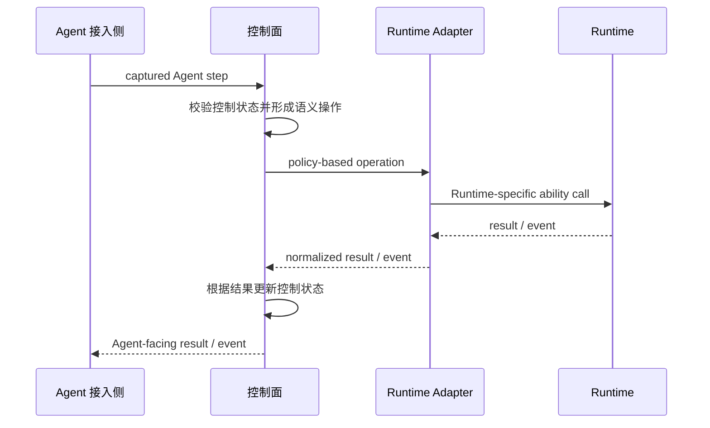

# AScout 架构

本文只定义 AScout 的一级分层、各侧所有权与跨侧调用方向。

## 1. 架构总览

AScout 由四个部分组成。控制面居于中间，两端分别通过 Adapter 稳定边界连接：一侧是 Agent 接入侧，其内部 ASC-Daemon / Interposer / Operation Integration 承担 Agent 侧接入适配（相当于 Agent 侧的 adapter）；另一侧是执行 Runtime，通过 Runtime Adapter 接入。

Agent 接入侧定义 Agent 接入/使用 AScout 的方式，绑定某个 Agent Instance 的本地上下文。控制面通过接入侧来实现对 Instance 生命周期、状态、行为、环境信息的控制。

控制面是 AScout 的主体部分，负责维护投机执行过程当中 Agent 的状态，特别是由多次投机执行组合嵌套形成的拓扑结构。同时还负责执行过程中的决策和检查，Policy 和 Adapter 都以可插拔的形式与该结构连接。这也意味着控制面还负责根据 Runtime contract 校验 Adapter 是否符合 AScout 所要求的基本语义，并解析回传事件。加载与校验 Policy，检查当前接入的 Runtime 能力是否满足 Policy 需求。 

Runtime Adapter 根据 contract 所定义的接入方式和基本能力完成 Runtime 对控制面的适配，并上报自身能力。把目标 Runtime 的能力映射成 Policy 可以利用组合的能力。在替换 Runtime 时需要替换 Adapter 的具体实现，但保持控制面语义不改变。Runtime Adapter 在实际部署中属于 AScout 底座，但因其变化与具体 Runtime 紧密相关，在架构描述中单独成为一侧。

Runtime 是最强制边界。其实现由环境级组件（执行环境、隔离、资源归属、状态转换、清理）组成。实际上 Agent-facing integration 组件（Interposer、ASC-Daemon、Operation Integration）也可以算作 Runtime 的一部分；后者部署在 Runtime 创建的 Branch 隔离环境内，运行生命周期由 Runtime 管理。

### 1.1 架构边界

- 所有跨边界的操作都必须遵守路径，并仅传输数据，而不能代为控制。跨侧调用沿 `Agent 接入侧 <-> 控制面 <-> Runtime Adapter <-> Runtime` 方向进行，各侧不越过相邻边界直接控制其他侧，也不共享跨侧可变状态。
- Runtime Adapter 只能适配和规范化，不能放宽 AScout 的基本规范；策略与 Runtime 能力不匹配时，由控制面决定拒绝或明确降级，Runtime 与 Adapter 不静默改变语义。
- 所需 OS privilege 只由 Runtime 或其内部组件持有；对外部世界的效果调用由 Runtime 负责执行与约束，控制面只形成效果计划与协调请求。

## 2. 控制闭环

一次需要 Runtime 参与的操作形成完整闭环：

控制面是整体 Speculative Tree 与控制语义的权威来源；Runtime 是执行、资源和机制转换状态的权威来源。

## 3. 内部组件与所有权

各侧拥有的组件与控制状态如下（控制面各组件的职责与协作见 [控制面设计](design/control-plane.md)）：

| 侧面 | 组件 | 状态 |
|---|---|---|
| Agent 接入侧 | ASC-Daemon、Interposer、Integration（Agent 接入：CLI、library、launcher 等） | 当前 Branch 的本地上下文绑定 |
| 控制面 | Entry API、Policy Engine、Assumption Manager、Scheduler、Effect Coordinator、Ledger | AScoutAgent 与 Speculative Tree 控制状态、Policy 绑定 |
| Runtime Adapter | 稳定的 contract 映射实现、通信组件与事件规范化、Runtime 状态获取 | 无长期状态 |
| Runtime | 内部组件由具体 Runtime 自行决定 | 节点执行状态、进程与资源归属、隔离、staged effect、obligation 等的权威状态 |

特别的，ASC-Daemon、Interposer 等 Agent 侧接入组件实际运行在 Runtime 创建的 Branch 隔离环境内。

## 4. 相关文档

- [设计决策](design/decisions.md)：核心 Speculative Tree 语义选择速查
- [投机执行底座设计决策](design/speculation-decisions.md) 与 [抽象设计札记](development/spec-exec-abstraction.md)：内部组件的研究推导
- [设计模型](design-model.md)：抽象概念层
