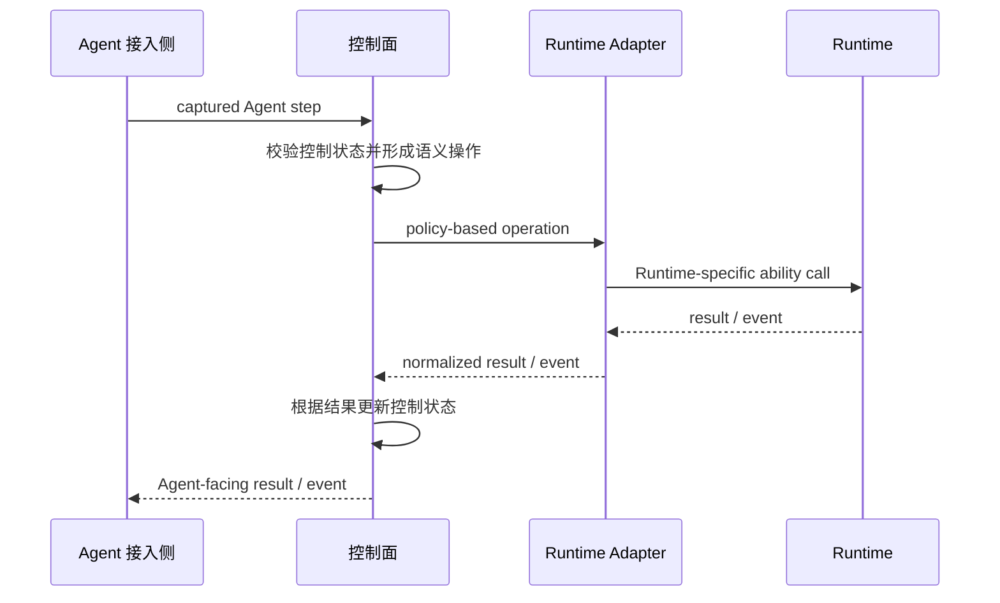

# AScout 架构

本文只定义 AScout 的一级分层、各侧责任与跨侧调用方向。四侧是一次完整调用中的逻辑位置，不表示四侧都由 AScout 实现或拥有。Mechanism 不是第五侧，而是横跨 Agent 接入侧与控制面的抽象实现责任。

## 1. 架构总览

用户端呈现稳定的 AScoutAgent 视图，与具体 Agent 执行实体分离。控制面确认合法 Promote 后，接入实现更新该视图对应的权威执行及输入、输出和中断路由；不通过切换或重建用户会话完成接替。用户端不新增一级架构侧面，也不拥有 Branch 接受裁决权。

用户端还可提供独立于主对话的只读候选观察，显示候选运行事实和明确标记为未验证的内容；观察不改变权威输出路由，不给候选建立用户输入通道，也不将观察内容反馈给其他 Branch。生命周期状态取自控制面，实际执行活动由接入侧报告，环境操作完成与否依据实际返回结果展示，不以命令已发出代替完成。

AScout 的完整调用路径涉及四侧。控制面居于中间，两端分别通过 Adapter 类边界连接：一侧是 Agent 接入侧，其内部 Interposer 承担 Agent 侧的拦截与操作集成，ASC-Proxy 承担受管控制通信；另一侧是外部执行 Runtime，通过 Runtime Adapter 接入。Agent 接入侧与控制面是 AScout 自身可以定义和实现的系统部分；Runtime Adapter 是面向控制面的接入实现；Runtime 是 AScout 依赖但不拥有的外部能力来源。

Agent 接入侧围绕一组 Agent 进程及其执行活动提供本地管理。Branch 为执行活动提供逻辑归属，Agent 接入侧为每个 Branch 承载独立的本地管理上下文；控制面通过接入侧获取 Agent 行为事实、发出控制命令，并协调 Branch 与 Instance 的全局状态。多个 Branch 可以在共享执行环境和接入侧承载中共存，Branch 建立独立环境后，其管理上下文随执行活动进入相应环境。

控制面负责维护投机执行过程当中 Agent 的控制状态，特别是由多次投机执行组合嵌套形成的拓扑结构。同时还负责执行过程中的决策和检查，Policy 和 Adapter 都以可插拔的形式与该结构连接。这也意味着控制面还负责根据 Adapter 接入契约校验其是否符合 AScout 所要求的基本语义，并解析回传事件；加载与校验 Policy，并检查 Adapter 所声明和呈现的后端能力是否满足 Policy 需求。逻辑 Branch 可以先进入控制面视图，独立 Runtime 环境按需建立，不要求每次投机执行都立即 fork。

控制面定义自己接受的稳定 operation/event 边界和接入条件。Runtime Adapter 的作者依据该边界，把目标 Runtime 的原生能力映射成控制面可以使用的能力，并规范化结果与事件。AScout 不规定 Adapter 内部如何调用 Runtime、如何组织模块或选择 transport；这些属于 Adapter 实现。AScout 只能通过接入校验与运行期结果判断 Adapter 是否兑现其声明，不能直接控制 Adapter 的内部行为。

Runtime 是外部执行后端，例如容器、虚拟机或进程管理能力。AScout 不定义其内部架构，也不要求它提供 AScout 专用接口。Runtime 负责执行环境、隔离、资源和环境级生命周期；由 Agent 造成且可能影响全局的外部效果由控制面内的 Effect Coordinator 实际处理，不属于 Runtime 的效果执行责任。Agent-facing integration 组件可以部署在 Runtime 提供的 Branch 隔离环境内，其运行生命周期随该环境管理，但不因此成为 AScout 可以定义的 Runtime 内部组件。

### 1.1 架构边界

- 所有跨边界的操作都必须遵守路径。跨侧可以传输受契约约束的请求、命令、结果和事件，但不能越过相邻边界直接控制其他侧，也不共享跨侧可变状态；调用方不能仅凭发送请求或更新自身状态伪造目标侧已完成的状态。
- 控制面不接受会放宽 AScout 基本语义的 Adapter 结果；策略需求与 Adapter 声明或实际兑现的能力不匹配时，由控制面拒绝或明确降级。
- 所需 OS privilege 留在外部执行后端一侧，Agent 接入侧、控制面与 Runtime Adapter 不持有这些特权。Runtime 的 OS 特权只用于环境、进程、资源和隔离边界；外部效果由 Effect Coordinator 负责处理，不转化为 Runtime 的效果执行责任。

## 2. 控制闭环

一次需要 Runtime 参与的操作形成完整闭环：

控制面是整体 Speculative Tree、控制语义和外部效果状态的权威来源。Runtime 内部的执行、资源和环境状态实际存在于外部 Runtime；控制面只接受 Runtime Adapter 按接入约定返回的环境能力、结果与事件，不直接定义或读取 Runtime 内部状态。

## 3. 责任与状态边界

四侧在调用路径中的责任如下（控制面各组件的职责与协作见 [控制面设计](design/control-plane.md)）：

| 侧面 | 组件 | 状态 |
|---|---|---|
| Agent 接入侧 | Interposer（拦截与操作集成）、ASC-Proxy（受管控制通信）、Product Integration（产品接入） | 当前 Agent 与 Branch 的本地执行上下文 |
| 控制面 | Agent Control Gateway、Adapter Registry、Policy Engine、Speculation Coordinator、Effect Coordinator、Ledger | AScoutAgent 与 Speculative Tree 控制状态、Policy 绑定、Adapter 接入状态 |
| Runtime Adapter | 实现控制面接入边界、能力映射、通信与事件规范化；内部实现由 Adapter 作者决定 | 不向控制面呈现第二份长期权威状态 |
| Runtime | 内部组件由外部 Runtime 自行决定 | 隔离执行环境及其环境级执行、进程、资源和边界状态；仅经 Adapter 暴露控制面所需的可观察结果 |

特别的，ASC-Proxy、Interposer 等 Agent 接入侧组件可以运行在 Agent 执行实体当前使用的执行环境内；该环境可以是多个逻辑 Branch 暂时共享的执行环境，也可以是 Runtime 为某个 Branch 建立的独立环境。

## 4. 相关文档

- [Agent 接入侧设计](design/agent-integration.md)：直接子文档，展开 Agent 接入组件与受控路径
- [控制面设计](design/control-plane.md)：直接子文档，展开控制面内部职责
- [Runtime Adapter 契约设计](design/runtime-adapter-contract.md)：Adapter 面向控制面的具体接入契约
- [Runtime Adapter 接入指南](development/runtime-adapter.md)：Adapter 作者的实现建议与控制面接入方法
- Runtime 不建立通用设计子文档
- [设计决策](design/decisions.md)：核心 Speculative Tree 语义选择速查
- [投机执行底座设计决策](design/speculation-decisions.md) 与 [抽象设计札记](development/spec-exec-abstraction.md)：内部组件的研究推导
- [设计模型](design-model.md)：抽象概念层
