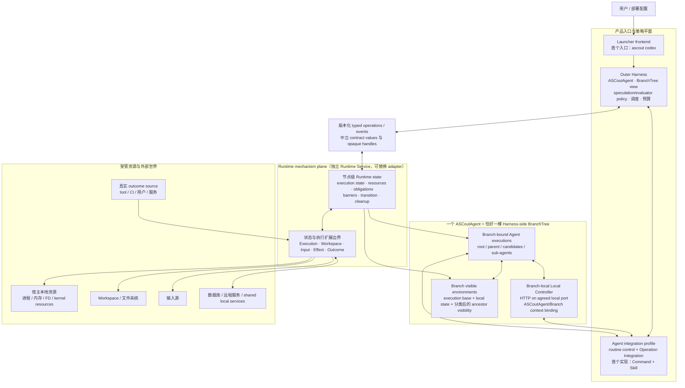
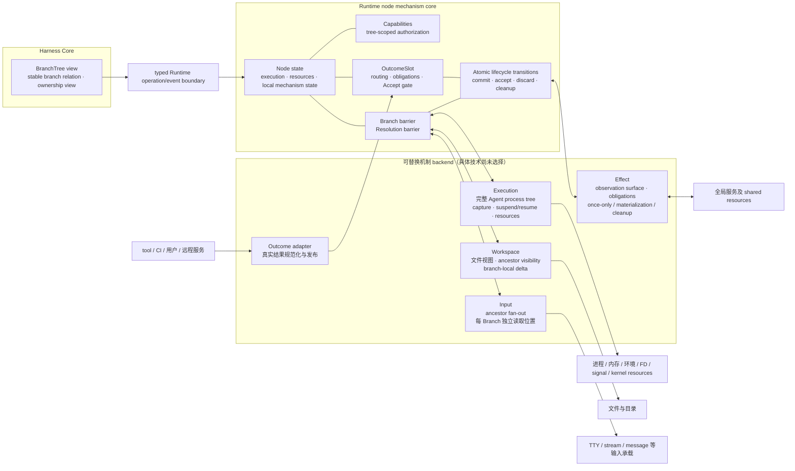
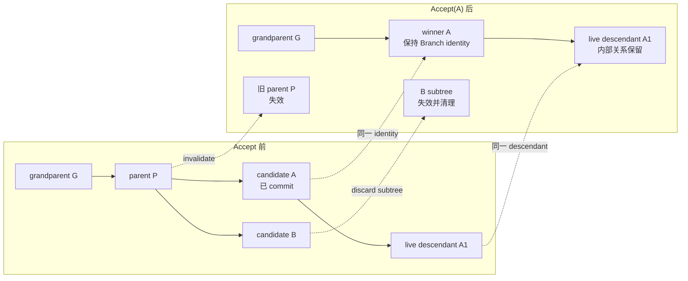
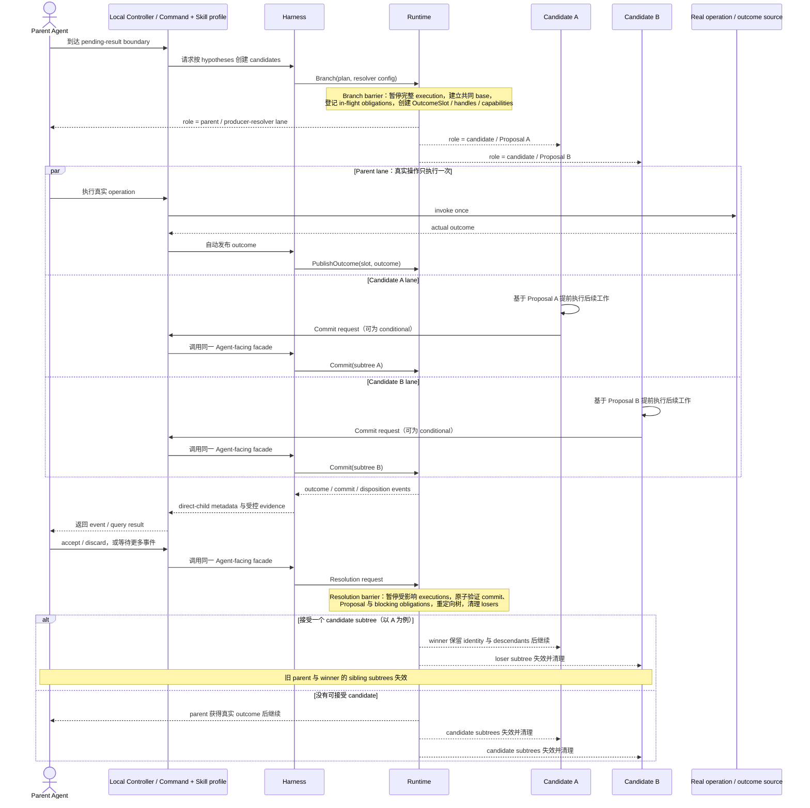
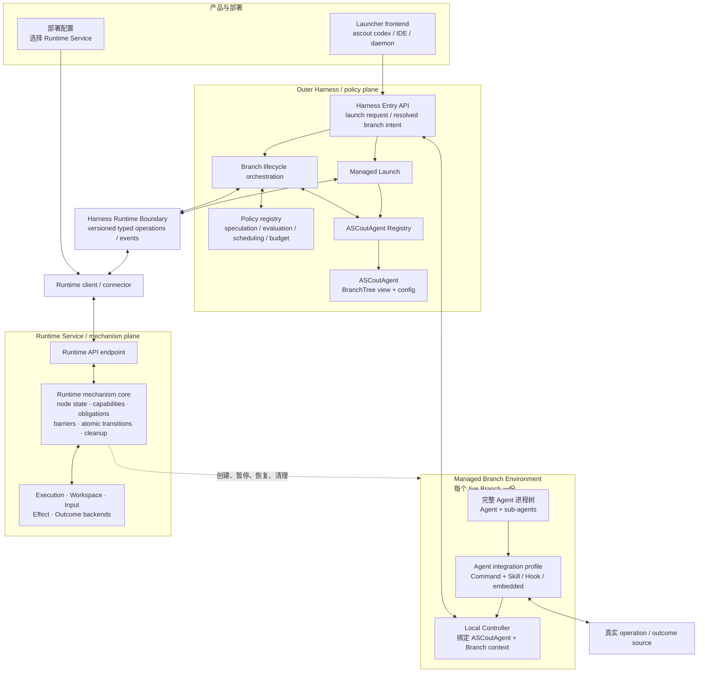

# ASCout 全局架构图集

本文把已经确认的 ASCout 目标语义放到同一套视觉坐标中，帮助读者建立全局视角。它是导航与可视化入口，不取代语义权威文档：目标行为以 [状态与生命周期语义](design/overview.md) 和 [设计决策](design/decisions.md) 为准，投机执行底座组件模型见 [投机执行底座设计决策](design/speculation-decisions.md) 与 [抽象设计札记](development/spec-exec-abstraction.md)。

仓库当前只有设计文档，没有实现。图中的 Runtime backend 和行为路径是已接受的目标架构或计划边界，不表示 lifecycle、isolation 或 security 已经实现。

## 一句话模型

ASCout 对外抽象为一个 ASCoutAgent；Harness 维护该 Agent 的 BranchTree、Agent integration 与可变的投机、评估和调度策略，Agent 或其授权 delegate 保有生命周期决策权；Branch-local Local Controller 隐藏当前 Branch context 并把 CLI/library 请求送入 Harness Entry API；Runtime 提供节点级执行状态、资源归属、隔离和状态转换机制。当真实 operation 尚未返回时，多个 candidate 基于 Proposal 提前继续，最终只接受一个完整 subtree，或让 parent 从真实 outcome 继续。

## 1. 系统上下文与所有权

这张图回答“谁作决定、谁强制正确性、Agent 实际运行在哪里”。边界是逻辑 ownership 与 typed API 边界；Runtime 以独立 Runtime Service 运行，Harness 负责选择并连接它。



关键边界：

- Agent/Harness policy 发起 candidate 创建；Candidate Agent 决定何时 commit；持有 resolver capability 的 parent Agent 或受托 Harness 决定 accept、wait 或 discard。Runtime 不内建搜索、调度或 candidate 质量策略。
- Harness 是 ASCoutAgent、BranchTree 视图和 Branch 关系的权威来源；Runtime 是节点执行状态、资源归属、barrier、obligation、状态转换与 loser cleanup 的机制来源。
- Branch-local Local Controller 是 Agent-facing context boundary：CLI/library 只发送无 ASCoutAgent/Branch 身份的 routine intent，Local Controller 用自身绑定形成 resolved request 后进入 Harness Entry API。第一版可用隔离环境内约定端口的 HTTP Server 实现。
- Agent integration profile 把 routine lifecycle intent 接到 Harness Entry API；其中的 Operation Integration 识别 pending-result boundary、保证真实 operation 只执行一次并自动发布 outcome。二者都不承担隔离或生命周期强制，未来 Hook/embedded profile 也必须复用同一 semantic API。
- OS privilege 只进入具体 Runtime 及其内部 helper/daemon，不进入 Harness、launcher、Agent 或 integration。

## 2. BranchTree 视图、Runtime 机制与世界状态

这张图展开 Harness 侧 BranchTree 视图、Runtime 节点级机制与可替换 backend 的关系。五个 Runtime-side extension 分别承担不同的机制与状态语义，不能合并成一个笼统的“Workspace backend”。



状态可见性不能用一条统一规则概括：

- Execution 从 Branch barrier 捕获的共同 execution base 开始，随后各 Branch 独立演化。
- Workspace 对具有覆盖语义的状态使用 latest-visible-write，并保持 sibling isolation。
- Input 从 ancestor fan-out，每个 Branch 维护独立读取位置；未读输入不阻塞 commit。
- Outcome 通过显式 event、Proposal compatibility 与 obligation 验证进入 Accept gate。
- Effect 只在 adapter 声明的 observation surface 与 guarantee horizon 内承诺 sibling non-interference。

### Branch tree 与 single-winner 转换

Branch 是唯一核心世界实体，状态不是另一棵树。下图以非 root parent 为例展示 `Accept(A)`；若 P 是 root，则 A 直接成为新 root。



Accept 不是 merge，也不是把 candidate 压回 parent identity。Winner 按每类状态的可见性规则延续已可见的 ancestor state、已验证 outcome 和已 materialize effect；parent 在 Branch 创建后的进程内存、Agent context 与评测 scratch 不传播。Branch 在树中是否 live 与其 execution 当前 running、waiting 或 suspended 是两条正交状态轴。

## 3. 一次投机执行的主时序

这张图展示 delayed-choice 场景中的主路径。Resolver 默认是 parent Agent，也可以在 ASCoutAgent 创建或 Branch 创建时显式委托给 Harness。图中的操作名只是语义标签，不是已经确定的 method、payload 或 Agent command schema。



这里没有 parent/candidate merge。Accept 是 Branch tree 的原子重定向：winner 保留自身 identity 和 live descendants，旧 parent 与不兼容 sibling subtrees 失效。

## 4. 目标组件模型

实现围绕投机执行底座的目标组件模型展开（`docs/development/spec-exec-abstraction.md` §10.4）。控制面与实例侧的关键边界如下，不重复语义细节：

- **Control Plane**：API Entry、Policy Engine（六类 policy 插件宿主）、Assumption Manager、Scheduler、Effect Coordinator、Ledger、Runtime Adapter。
- **Instance 侧**：Interposer、Agent、ASC-Daemon、Isolation Env。
- **边界**：Agent Boundary（Interposer，四接缝：LLM 调用、工具分发、轨迹写入、调度）与 Isolation Boundary（Runtime Adapter，docker / firecracker / gVisor / QEMU / 自研）必需；Engine Boundary 在范围外。
- Runtime Adapter 通过契约协商把后端能力差异上报给 Policy Engine，同一个 policy 在不同后端上自动得到不同的激进度。
- Ledger 是异步旁路，不在关键路径上；Assumption Manager 的 `resolve()` 坐在关键路径上。

未来实现的 crate/模块与依赖组织直接围绕上述组件模型重新决定（开发决策 D-023-I）。

## 当前实现状态

```text
目标语义与组件模型：已形成并有设计文档
当前实现：无
Runtime lifecycle / isolation：未实现
Execution / Workspace / Input / Effect / Outcome backend：未选择或未实现
Command + Skill / ascout codex：计划中的首个 integration profile
```

因此，当前最重要的架构事实不是“某项 backend 已经可用”，而是 ownership、生命周期不变量、替换边界和验证顺序已经明确。实现进度以 [开发路线图](development/roadmap.md) 和 [验收状态](development/verification.md) 为准。

