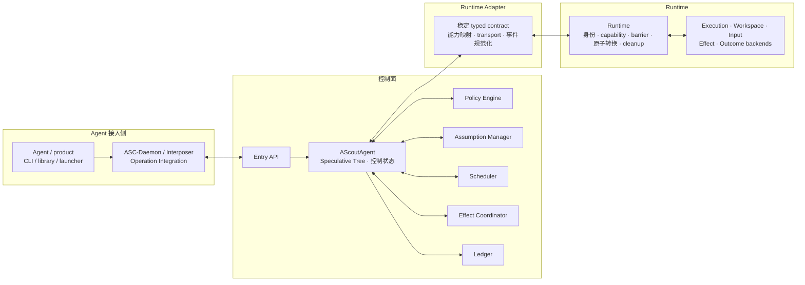
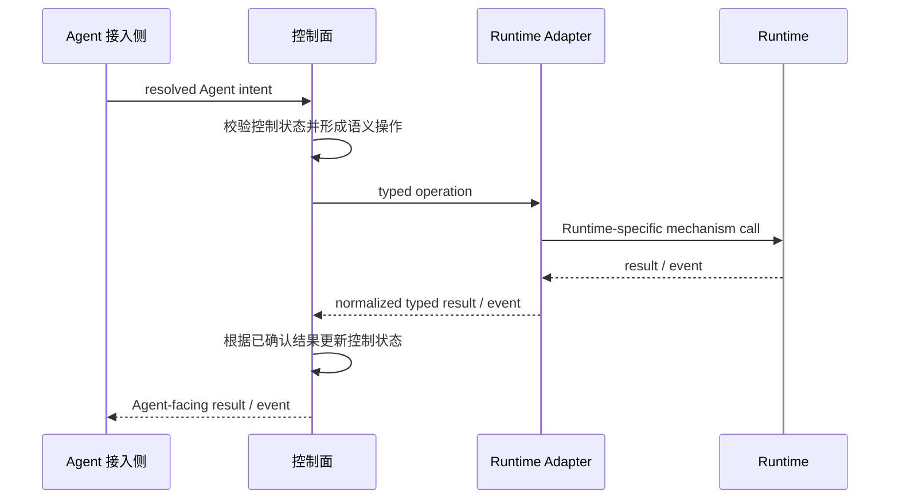

# AScout 架构

本文是 AScout 的**系统结构文档**：它定义通用底座的实现组织方式。底座"要解决什么问题、靠什么核心模型工作"见 [心智模型](mental-model.md)；本文只回答"系统怎么组织、每侧拥有什么、怎么跨侧协作"。

本文只定义 AScout 的一级分层、各侧所有权与跨侧调用方向。Branch 生命周期、状态可见性和 single-winner 语义以 [状态与生命周期语义](design/overview.md) 与 [设计决策](design/decisions.md) 为准；内部组件的研究推导见 [投机执行底座设计决策](design/speculation-decisions.md) 与 [抽象设计札记](development/spec-exec-abstraction.md)。

## 1. 一级分层

AScout 采用四个连续侧面：

```text
Agent 接入侧 -> 控制面 -> Runtime Adapter -> Runtime
```

AScout control 请求按这个方向下行，结果与事件沿相反方向返回。四侧是逻辑责任边界，不等同于四个 crate、四个进程或四种部署单元。



Runtime Adapter 自身定义控制面依赖的稳定、typed、可版本化 operation/event contract，并把该 contract 映射为目标 Runtime 的能力、原语、transport 和返回事件。替换 Runtime 时替换 Adapter 的具体实现，不改变控制面语义。Runtime Adapter 在实际部署中属于 AScout 底座，但因其变化与具体 Runtime 紧密相关，在逻辑架构中单独成为一侧。

## 2. 各侧职责

| 侧面 | 拥有 | 不拥有 |
|---|---|---|
| Agent 接入侧 | Agent/product 调用形式、当前 Branch 的本地上下文绑定、operation 接入和结果呈现；Agent/resolver 在授权范围内作 lifecycle 决定 | AScout 全局控制状态、Runtime 机制状态 |
| 控制面 | AScoutAgent、Speculative Tree、控制状态、policy、请求校验、操作编排和 Runtime 事件解释 | Runtime mutable state、OS privilege、具体 Runtime transport 或 backend 原语 |
| Runtime Adapter | 稳定 Runtime contract、具体 Runtime 能力映射和协议适配 | Agent/product 语义、policy 决策、Speculative Tree 权威状态、Runtime 内部机制状态 |
| Runtime | 节点执行状态、进程与资源归属、隔离、capability/obligation validation、barrier、原子状态转换和 cleanup | Agent prompt、candidate 质量、控制面 policy 或整体 Speculative Tree 视图 |

关键约束：

- Agent 接入侧不能绕过控制面发起 AScout lifecycle/control operation；Agent execution 对 Workspace、Input 等运行资源的正常访问仍由 Runtime 强制管理。
- 控制面不能绕过 Runtime Adapter 直接依赖某个 Runtime，也不能先修改控制状态再假定 Runtime 操作已经成功。
- Runtime Adapter 只能适配和规范化，不能放宽 AScout lifecycle、single-winner、capability、obligation 或 cleanup 规则。
- Runtime 强制机制正确性，但不替 Agent、resolver 或 policy 作运行策略选择。
- AScout control path 只通过显式 contract 跨侧交换数据，不共享跨侧可变内部状态。

## 3. 控制闭环

一次需要 Runtime 参与的操作形成完整闭环：



控制面是整体 Speculative Tree 与控制语义的权威来源；Runtime 是执行、资源和机制转换状态的权威来源。Runtime Adapter 不建立第二份长期权威状态。涉及 Branch、Accept、Discard 或 cleanup 的操作，只有 Runtime 确认完成后，控制面才能 finalize 对应状态。

## 4. 内部组件位置

Entry API、Policy Engine、Assumption Manager、Scheduler、Effect Coordinator 与 Ledger 都属于控制面内部组件，不构成新的一级侧面。AScoutAgent 与 Speculative Tree 是控制面拥有的控制状态，不是额外组件。Effect Coordinator 只形成效果分类、计划和协调请求；staged effect、obligation、materialization 与 cleanup 的权威状态仍属于 Runtime。Runtime 以及 Execution、Workspace、Input、Effect、Outcome backend 属于 Runtime 内部。ASC-Daemon、Interposer、CLI、library 和 launcher 属于 Agent 接入职责，即使其中部分部署在 Runtime 创建的 Branch 隔离环境内。

Agent execution、Branch 隔离环境及其进程和资源是 Runtime 管理的运行对象，不是第五个架构侧面。组件的 crate 划分、进程边界、具体 Adapter transport、Adapter discovery 和连接生命周期仍属于后续实现设计。

## 当前状态

仓库当前只有设计文档，没有实现。四侧分层是目标架构；具体 Runtime Adapter、Runtime backend 和跨侧协议尚未实现。实现进度以 [开发路线图](development/roadmap.md) 与 [验收状态](development/verification.md) 为准。
