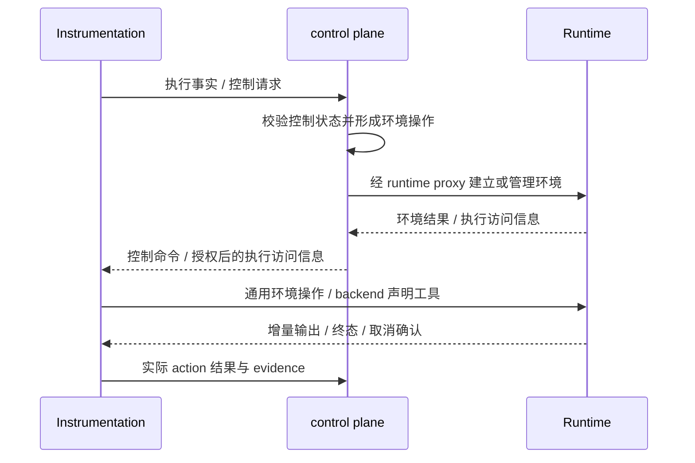

# AScout 架构

本文只定义 AScout 的一级分层、各侧责任与跨侧调用方向。Runtime 是 AScout 支持的一套完整执行与效果承载系统；runtime proxy 是它与 control plane 之间的接入边界，不是与 Runtime 平级的另一侧。Mechanism 不是额外的一侧，而是横跨 Instrumentation、control plane 与 Runtime 的抽象实现责任。

## 1. 架构总览

Instrumentation 上报通用 action 生命周期及 Agent/Branch 元事件，控制命令回执只确认 Instrumentation 落实；Runtime 独立报告操作、环境及资源结果。Authority/Candidate 是 Tree 的角色，不是两种 Agent 事件协议。具体边界见 [Agent 接入](design/agent-integration.md)。

用户端呈现稳定的 AScoutAgent 视图，与具体 Agent 执行实体分离。control plane 确认合法 Promote 后，接入实现更新该视图对应的权威执行及输入、输出和中断路由；不通过切换或重建用户会话完成接替。用户端不新增一级架构侧面，也不拥有 Branch 接受裁决权。

候选承接后续执行时继续使用候选环境；Instrumentation 与 Runtime 保持执行、环境及必要状态交接的一致性，嵌套接受仍受祖先约束。Agent 常用 Ctrl-C 或退出终止任务；Ctrl-C 保留程序和 session，结束候选并等待相关写入及物化处理后，在同一对话中接下一轮。AScout 的独立暂停接口保留树、候选和环境；具体边界见 [Agent 接入设计](design/agent-integration.md) §5。

工具与模型推理均可由 Policy 选择 eager（权威调用与候选并行）或 speculative-first（权威调用在执行前等待，独立候选先行）。候选被接受后 Promote 其 session 并取消旧 Parent，不向旧调用注入候选结果；全部候选不可接受时原调用只放行一次。Parent 已放行并取得真实结果后可以立即继续，不以候选验证结束阻塞结果交付。工具准入与结果兼容性由 Policy 结合接入能力判断，operation 归属与结果配对由 Mechanism 保证。

用户端还可提供独立于主对话的只读候选观察，显示候选运行事实和内容；候选内容与主对话分开展示，并随 Branch 的角色与状态显示其投机身份。观察不改变权威输出路由，不给候选建立用户输入通道，也不将观察内容反馈给其他 Branch。生命周期状态取自 control plane，实际执行活动由 Instrumentation 报告，环境操作完成与否依据实际返回结果展示，不以命令已发出代替完成。

AScout 的用户界面接收并呈现 Agent 输出与运行事件，不依赖某个 Agent 产品的原生界面；产品差异由对应 Agent 接入实现处理。UI 不独立部署，由 control plane 启动，边界见 [control plane §2.1](design/control-plane.md#21-gateway)。观察覆盖当前 AScoutAgent 的完整 Tree，支持从 Branch 关系与状态进入具体 Branch 的只读详情，不提供跨 Tree 查询或生命周期裁决权限。

AScout 的完整调用路径涉及 Instrumentation、control plane 和 Runtime。control plane 一侧通过 Agent 接入边界接收 Agent 行为，另一侧通过 runtime proxy 使用 Runtime。Instrumentation 与 control plane 是 AScout 自身可以定义和实现的系统部分；Runtime 是 AScout 支持的完整承载系统；runtime proxy 负责把 Runtime 接入 control plane。

Instrumentation 围绕一组 Agent 进程及其执行活动提供本地管理。Branch 为执行活动提供逻辑归属，Instrumentation 为每个 Branch 承载独立的本地管理上下文；control plane 通过 Instrumentation 获取 Agent 行为事实、发出控制命令，并协调 Branch 与 Instance 的全局状态。多个 Branch 共用 Backend 内部资源，但 Environment 身份按 Branch 独占；Branch 建立独立环境后，其工作区访问、shell、受管子程序及效果进入相应环境；Agent 与随附 Instrumentation 留在环境外的可信宿主，由 Runtime 管理启动、监视和回收。

完整执行须先建立受管 Runtime 边界，再创建 root Agent。当前 CLI 启动一个前台 control plane，并由其管理该次 run 的连接、界面与关闭。

control plane 负责维护投机执行过程当中 Agent 的控制状态，特别是由多次投机执行组合嵌套形成的拓扑结构。同时还负责执行过程中的决策和检查，Policy 和 runtime proxy 都以可插拔的形式与该结构连接。Runtime 启动入口读取节点配置并装配各组件。backend registry 登记 backend 实现、程序入口、接口与能力声明，并核对所需标准接口。base runtime 创建并管理实例、Environment 关联及操作结果，编排宿主与环境执行资源的启动、保存恢复和关闭。control plane 使用其能力视图加载与校验 Policy，并解析回传事件、检查请求和实际结果是否符合控制语义。逻辑 Branch 可以先进入 control plane 视图，独立 Runtime 环境按需建立，不要求每次投机执行都立即 fork。

control plane 定义自己接受的稳定 operation/event 边界和接入条件。Gateway 属于 control plane，不独立部署，由 control plane 统一启动和停止；UI 同样由 control plane 启动和停止。该归属不规定必须同进程，也不要求自动打开浏览器。Gateway 负责 Instrumentation、UI、control plane 与 Runtime 之间的通信接入、消息分发和送达，与 Runtime 采用网络通信；对应侧的控制逻辑决定消息如何影响自身状态。runtime proxy 依据 control plane 边界，把 Runtime 的能力映射成 control plane 可以使用的能力，并规范化结果与事件。Runtime 内部可以组合 Overlay、进程、容器、Firecracker 等能力；External Effect Coordinator 属于 Runtime，处理本机隔离覆盖不到的外部 API，与 network backend 协同。它无需为跨 Branch 命令去重掌握整棵树，control plane 只在 Branch 被接受、丢弃或前提失效时通知相应暂存请求释放或取消。不能模拟时，请求仍暂存在本机，Branch 在效果边界阻塞并保留进展，待成为权威后发送真实请求并继续；可模拟时才提供明确标记来源的临时结果。AScout 不规定这些内部模块如何组织或选择 transport，但要求接入边界如实呈现能力和限制。

Runtime 承载 Agent 的一步动作，使动作能够正常、正确地运行，并把动作对真实世界或 authority 的影响限制在允许范围内。Runtime 负责动作所需的环境、状态派生、隔离、资源、进程和效果边界；这些能力可以按任务需要共享、复制、写时复制、重建或恢复。Agent Session 的内部管理由 Instrumentation 负责。Agent 与随附 Instrumentation 运行在 Branch 隔离环境外的可信宿主，其 run 级唯一宿主由 agent supervisor 管理；模型、内存和控制通信直接使用宿主路径，工作区访问及受管进程必须使用对应 Branch 的 Runtime 环境。Branch 挂载切换和物化不要求重启 Agent 宿主。

每个 session 对应一个 AScoutAgent 和一棵 Speculative Tree，具体投机状态集中在树中。task 是 Agent 的一轮工作，完成本轮工作并开始等待用户输入时结束。Speculation Coordinator 负责树、Policy 函数和外部操作之间的协调，不持有 session 的第二份投机状态，可以供多棵树使用。消息与到期检查按树顺序处理；Runtime 操作和 Policy 求值异步返回，由树校验并应用。长期设计允许修改 Policy；当前首版同一 session 加载的 Policy 固定，不实现修改或切换，范围见 [Policy 开发说明](development/policy-engine.md)。事件等待和通信入口不承担投机策略或状态转换职责。

Runtime 通过接入边界报告物化完成或失败；物化失败按操作失败处理。control plane 必须等待物化成功后才能宣告任务成功，具体条件见 [Runtime 设计](design/runtime.md)。

### 1.1 架构边界

- 所有跨边界的操作都必须遵守路径。跨侧可以传输受契约约束的请求、命令、结果和事件，但不能越过相邻边界直接控制其他侧，也不共享跨侧可变状态；调用方不能仅凭发送请求或更新自身状态伪造目标侧已完成的状态。
- control plane 不接受会放宽 AScout 基本语义的 runtime proxy 结果；策略需求与 runtime proxy 声明或实际兑现的能力不匹配时，由 control plane 拒绝或明确降级。
- 所需 OS privilege 留在 Runtime 实现一侧，Instrumentation、control plane 与 runtime proxy 不持有这些特权。Runtime 的特权只用于其声明的环境、进程、资源、隔离和效果边界；Instrumentation 不能绕过 Runtime 或 control plane 直接扩大动作影响范围。

## 2. 控制闭环

环境生命周期等控制操作经 control plane 与 runtime proxy 形成闭环；工具执行则使用 control plane 已授权并交付的独立执行连接：

Product Integration 独立适配产品工具参数、schema 和结果格式化，一次完整工具调用对应一次完整 Runtime 操作，不复用 Pi 工具实现。统一接收端验证 Branch、Environment 与请求身份后分派到当前 backend；文件系统 holder 与 Firecracker guest agent 在各自原生环境执行完整 read_file、write_file、replace_text、list_directory、exec，不加载 Pi SDK，也不由宿主读取、修改后回写文件。backend 声明工具经过同一接收端，业务语义留在 backend。共同生命周期保留 accepted、output、终态、取消、确认与重放；执行请求不创建新环境。



control plane 是整体 Speculative Tree 和控制语义的权威来源。Runtime 内部的执行、资源、环境和效果状态由 Runtime 管理；control plane 通过 runtime proxy 接收能力、结果与事件，不直接读取 Runtime 内部状态。

## 3. 责任与状态边界

各责任边界如下（control plane 各组件的职责与协作见 [control plane 设计](design/control-plane.md)）：

| 侧面 | 组件 | 状态 |
|---|---|---|
| Instrumentation | Interposer（拦截与操作集成）、ASC-Proxy（受管控制与独立执行通信）、Product Integration（产品接入） | 当前 Agent 与 Branch 的本地执行上下文 |
| control plane | Gateway、UI Projection、Policy Engine、Speculation Coordinator、Ledger | AScoutAgent 与 Speculative Tree 控制状态、Policy 绑定、请求校验与投机编排；Gateway 只持有通信所需状态；界面缓存与连接读取位置由 UI Projection 管理，系统运行日志由进程持有 |
| Runtime | 包含 runtime proxy 接入边界及所需的执行、状态派生、进程、资源、隔离和效果管理能力；Registry 属于 Runtime | 管理实际承载、能力声明校验与效果状态；不决定 Speculative Tree 的全局裁决，不呈现第二份 Tree 权威状态 |

ASC-Proxy 是 Instrumentation 进程内的受管 Unix socket 客户端，不另设代理进程；它与 Interposer 随 Agent 留在 Branch 隔离环境外的可信宿主，由 Runtime 管理。Environment 身份按 Branch 独占；候选 session 保持独立，不因共用宿主进程而合并上下文。环境内受管子程序仍须按环境归属取消和清理。

执行端点以共同准入边界协调 Branch 取消与新操作：取消等待已接受操作终态和后台写者清理；清理成功后仅新执行 generation 可进入，旧请求不能复活。清理失败时保持准入关闭并允许重试。恢复时 control plane 重新向 Instrumentation 提供当前执行访问信息，不复用旧端点。

## 3.1 代码模块结构

`src/` 按职责分为三个顶层模块，`lib.rs` 只声明它们：

```text
src/
  lib.rs
  protocol/                    线上契约与传输编解码
    mod.rs  contract.rs  transport.rs
  control_plane/               control plane
    mod.rs
    speculative_tree/          Tree、Branch 状态及消息驱动的合法转换
    coordination/              SpeculationCoordinator、session 启动与请求协调
    ledger.rs
    policy/                    YAML 编译、Python 求值、Decision、校验
    gateway/                   Agent、UI 与 Runtime 通信接入
      agent/protocol.rs        Agent 消息、命令和线封装
    observation.rs             只读观察事件
    recovery.rs                恢复资料校验与发布
  runtime/                     runtime proxy 进程与通用组合层
    mod.rs
    proxy/                     会话、队列、结果缓存、分发与接入取消
    backend_registry.rs        backend 实现登记与接口检查
    backend.rs                 Backend trait、BackendContext、错误类型
    base.rs                    实例管理、Environment 关联、启停与恢复编排
    lifecycle.rs               base runtime 操作受理、排空与保留状态
    executable_backend.rs      独立程序接口与进程回收
    capabilities.rs            多 Backend 能力合并
    selection.rs               选择 Policy、路由与 BackendConnection
    agent_supervisor.rs           run 级 Agent 与 Instrumentation 宿主
    process/                   环境进程的 bwrap、cgroup 和进程组实现
    backends/
      mod.rs
      filesystem/              文件系统 Backend
      firecracker/             Firecracker Backend 与 guest_agent
      nle.rs                   NLE Backend
  bin/                         可执行入口、配置读取与装配
```

文件系统 Backend 继续按职责拆分：`config`、`state`（环境/挂载/快照/迁移）、
`probe`、`refs`、`mounts`、`btrfs`、`ops/{fork,mark,diff,accept,discard}`、
`layer/`（Node/View、扫描、解析、xattr、变更列表）、`merge`、`replay/`
（SafeRoot 与重放）、`copy`、`backend_impl`、`util`、`tests/`。

依赖方向：

- `protocol` 只依赖 serde 等外部库，不依赖 `control_plane` 或 `runtime`。
- `control_plane` 依赖 `protocol`；当前不依赖 `runtime`。
- `runtime` 依赖 `protocol` 与具体 Backend；Backend 实现依赖 `runtime::backend`
  的 trait 和 `runtime::launch_plan` 的启动片段，不反向把 workload 语义加入通用
  runtime proxy 或 control plane。
- `bin/` 读取并规范化启动配置，使用库的公开 API 装配各组件。

control plane 入口保留参数、配置、组件装配、进程与界面生命周期。`coordination::session` 根据记录准备 Tree，校验 Policy／Runtime 绑定并协调 Agent 启动或恢复。`coordination::execution` 负责事件循环、命令交付、观察发布和收尾。Tree／BranchRecord 的领域转换通过库接口完成。实现与验证范围见[源码责任边界核查](development/source-boundary-audit-2026-11-16.md)。

`BaseRuntime` 根据登记项创建实例，使用统一的 `Backend` 接口为 Environment 协调所有实际参与的实例。`FilesystemBackend` 管理文件视图、holder 冻结和恢复、挂载轮换与清理。独立程序通过标准接口接收生命周期和工具操作消息。见 [独立程序接入](development/executable-backend.md)。

## 4. 相关文档

- [Instrumentation 设计](design/agent-integration.md)：直接子文档，展开 Agent 接入组件与受控路径
- [control plane 设计](design/control-plane.md)：直接子文档，展开 control plane 内部职责
- [runtime proxy 契约设计](design/runtime-adapter-contract.md)：runtime proxy 面向 control plane 的具体接入契约
- [runtime proxy 接入指南](development/runtime-adapter.md)：runtime proxy 作者的实现建议与 control plane 接入方法
- [Runtime 设计](design/runtime.md)：动作承载、状态与可插拔能力；首阶段范围见开发文档。
- [设计决策](design/decisions.md)：核心 Speculative Tree 语义选择速查
- [投机执行底座设计决策](design/speculation-decisions.md)：投机执行底座的设计选择与理由速查
- [抽象设计札记](development/spec-exec-abstraction.md)：内部组件的研究推导
- [设计模型](design-model.md)：抽象概念层
